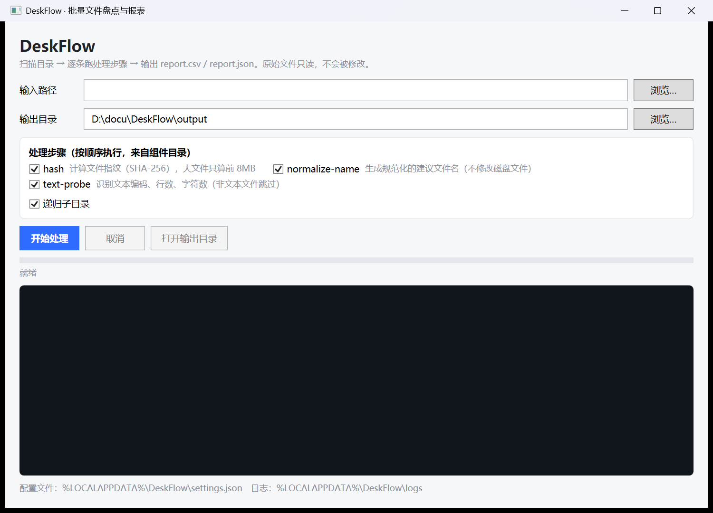

# DeskFlow

Windows 上用的小型批处理工具框架：**扫描目录 → 逐条跑处理步骤 → 输出一份可读的报表**。
原始文件全程只读，不会被修改；所有动作都能在命令行复现，也能挂 Windows 计划任务。

当前版本 `0.1.0`，默认能力是一份"文件盘点报表"（路径、大小、修改时间、SHA-256、建议文件名、文本编码/行数）：

```
report.csv    ← Excel 双击即开（UTF-8 BOM，中文不乱码）
report.json   ← 给程序/后续流程读
```

---

## 1. 先说清楚三件事（目标 / 输入 / 输出）

按目前实现落地的默认假设，逐项对照，改哪一项我就改哪一层：

| 维度 | 默认假设 | 换成别的会动哪一层 |
| --- | --- | --- |
| **目标** | 批量盘点本地文件并出报表（可扩成批量改名、批量转换、定时巡检） | 只增删 `IPipelineStep` 实现，引擎与界面不动 |
| **输入** | 一个目录（可递归），也支持单个文件 | 新增 `IInputSource`（网页、接口、数据库、扫码枪） |
| **输出** | `report.csv` + `report.json` 到指定目录 | 新增 `IOutputSink`（Excel、上传接口、邮件、打印） |
| **交付** | 绿色免安装单文件 EXE（自包含 .NET 运行时，约 59 MB） | 换成框架依赖版约 2 MB，或加安装包/自动更新 |

> 目标不是"文件盘点"而是别的（比如网页采集、串口设备、定时监控），
> 只要输入输出这两端各换一个适配器，引擎、界面、打包方式全部复用。

---

## 2. 运行

### 2.1 图形界面

```
dist\DeskFlow.exe
```

选输入目录 → 勾步骤 → 开始处理。日志区实时显示进度，取消按钮随时可中断（已完成的条目仍然有效）。



### 2.2 命令行（同一份可执行文件）

```powershell
# 全流程
.\dist\DeskFlow.exe --run "D:\待整理" --out "D:\报表"

# 只要指纹，不递归
.\dist\DeskFlow.exe --run "D:\待整理" --steps hash --no-recurse

# 帮助
.\dist\DeskFlow.exe --help
```

退出码：`0` 全成功 / `1` 有失败条目 / `2` 参数或运行错误 —— 可直接被计划任务、CI 用来判成败。

挂计划任务示例：

```powershell
$action  = New-ScheduledTaskAction -Execute 'C:\Tools\DeskFlow.exe' `
         -Argument '--run "D:\待整理" --out "D:\报表"'
$trigger = New-ScheduledTaskTrigger -Daily -At 8:30
Register-ScheduledTask -TaskName 'DeskFlow 每早盘点' -Action $action -Trigger $trigger
```

---

## 3. 构建

需要 .NET SDK 10（本机已装 10.0.401）。

```powershell
dotnet build DeskFlow.sln          # 编译
dotnet run --project tests\DeskFlow.Checks   # 25 项自检，零第三方依赖
powershell -File build\pack.ps1    # 打包单文件 EXE 到 dist\
```

`pack.ps1` 默认自包含（目标机无需装 .NET）；加 `-FrameworkDependent` 可只出 ~2 MB 的薄壳。

---

## 4. 目录结构

```
src/
  DeskFlow.Core/            领域模型 + 抽象 + 任务引擎（不依赖 Windows、不依赖 WPF）
    Models/                 InputItem / ProcessedItem / JobDefinition / JobReport
    Abstractions/           IInputSource / IPipelineStep / IOutputSink / IJobObserver
    Runtime/                JobContext / JobCatalog / JobEngine
  DeskFlow.Infrastructure/  具体实现（文件系统、SHA-256、文本探测、CSV/JSON 报表、日志、配置）
  DeskFlow.App/             WPF 界面 + 命令行双入口
    Cli/                    --run 参数解析与控制台附加
    ViewModels/             MVVM（无第三方框架）
tests/
  DeskFlow.Checks/          零依赖自检程序（25 项，退出码即结果）
build/pack.ps1              单文件打包
docs/                       架构说明与决策记录
```

依赖方向严格单向：`App → Infrastructure → Core`，Core 不认识任何上层。

---

## 5. 加一个新能力要改哪里

| 想加的东西 | 动作 |
| --- | --- |
| 新处理步骤（如"图片尺寸"、"Excel 去重"） | 写一个 `IPipelineStep` → 在 `DefaultJobCatalog.Build()` 里 `AddStep` 一行 |
| 新输入（网页 / 接口 / 数据库） | 写一个 `IInputSource` → `AddSource` 一行 |
| 新输出（Excel / 上传 / 邮件） | 写一个 `IOutputSink` → `AddSink` 一行 |
| 新界面元素 | 界面里步骤开关是**从组件目录生成的**，注册完自动出现，XAML 不用改 |

单条数据的失败只影响该条（`ContinueOnItemError` 可关），不会让整批任务崩掉。

---

## 6. 运行期文件

| 路径 | 内容 |
| --- | --- |
| `%LOCALAPPDATA%\DeskFlow\settings.json` | 上次输入/输出目录、递归开关 |
| `%LOCALAPPDATA%\DeskFlow\logs\*.log` | 每次运行的完整日志 |

不写注册表、不写 Program Files，卸载 = 删 exe + 删上面这个目录。
