# TidyFlow · 文件管家

> 产品需求文档见 [PRD.md](PRD.md)（功能、界面结构、模块关系以它为准；新增功能会同步更新）。

常驻 Windows 桌面的**文件管家**：自动接住 QQ / 微信 / 钉钉收到和浏览器下载的文件，按类型分门别类归档；桌面上一个面板就能打开最近的文件、进入分类目录、启动常用程序。

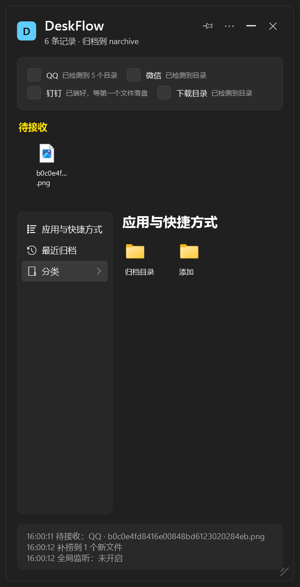

---

## 一、四个任务，现在做到哪一步

| 任务 | 现状 | 怎么用 |
| --- | --- | --- |
| **1. 监听 QQ / 微信 / 钉钉的文件并自动下载** | 已实现（目录监听 + 写完检测）。每个来源独立「自动下载」勾选：勾上 = 发现即归档；不勾 = 只进面板「待接收」，点一下才归档 | 面板顶部四个勾选框；设置 →「监听与自动下载」可加自定义监听目录 |
| **2. 自动归档 + 自动建类别 + 自定义类别** | 已实现。内置 6 类（办公文档/代码/图片/音视频/压缩包/安装包）+ 兜底「其他」，按扩展名自动建 <归档根>/<类别>/；设置里可新建自定义类别，同名会**并集**内置扩展名而不是覆盖丢弃 | 设置 →「分类规则」；归档位置在「归档位置」页 |
| **3. 在软件里打开文件** | 已实现。点图标 = 用系统默认程序打开；右键 = 打开 / 在资源管理器中显示 / 从面板移除 | 面板「最近归档」「待接收」「分类」 |
| **4. 常驻桌面，像截图那样** | 已实现。无边框面板（Win11 走 DWM 圆角），图标取自系统真实图标；**拖边角可改宽高，列数/图标/字号跟着自适应**；标题栏可拖、可「顶住」锁位置 | 面板右上角：顶住 / 设置 / 批处理 / 收起 / 退出；边缘拖动 = 缩放 |

> 明确边界：**没有**去 hook QQ/微信/钉钉客户端进程、也没有逆协议。
> 取舍见 [ADR 0003](docs/adr/0003-file-interception.md)：目录监听对客户端升级免疫、不需要注入、不会被杀软按注入行为拦截。

### 面板可以拖大拖小（内容自适应）

抓住面板任意边或角拖动即可改尺寸，松开后立刻重排并存进配置：

| 宽度 | 列数 | 效果 |
| --- | --- | --- |
| 280–360 | 3 列 | 窄栏贴边，标题自动折两行，副标题按需隐藏 |
| 376（默认） | 4 列 | 与参考图一致 |
| 560 以上 | 6–8 列 | 变成横向看板，一屏扫完最近文件 |

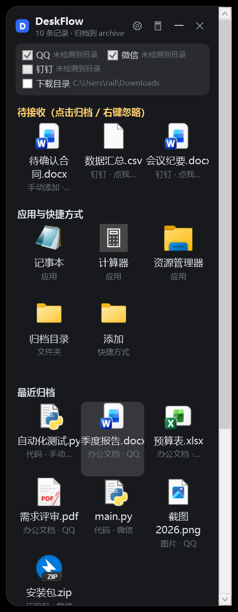


> 文字不会出现"半个字"：格子按当前宽度算好字数预算（中文按全角、ASCII 按 0.56）再截断加省略号，
> 换 DPI、换字体都不会错位；完整名字在鼠标悬停提示里。

### 拖动与「顶住」

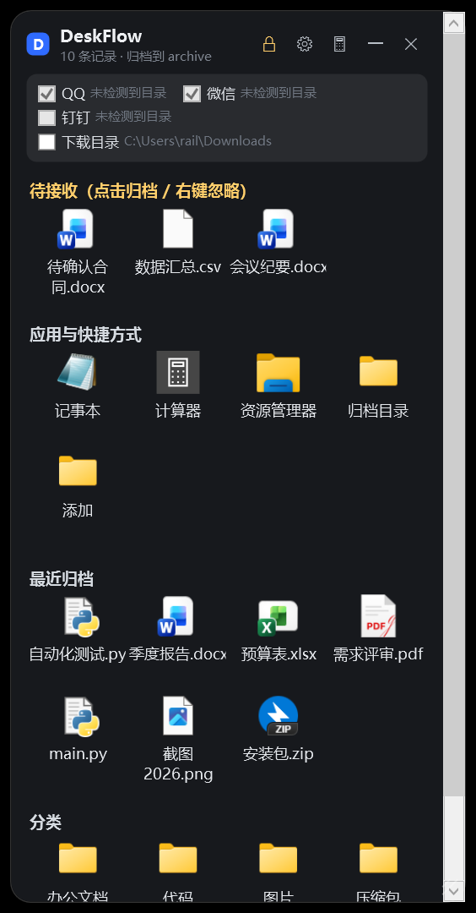

- **拖动**：按住标题栏拖动即可移动，走 Windows 原生 `HTCAPTION`，能贴边、不会抖；双击标题栏不会最大化（已吞掉该消息）。
- **顶住**：标题栏右侧第一个按钮（📌）点一下锁死位置，图标变成琥珀色锁 🔒，再点解除。状态存在 `settings.json` 的 `panel.pinned`，下次启动保持。
- **互不干扰**：贴边 14px 内是缩放，标题栏右侧 148px 留给按钮，所以点按钮不会被当成拖窗口；顶住只锁"移动"，拉边角缩放照常可用。

命中规则是一段纯函数（`DeskFlow.Core/Shell/PanelHitTest.cs`），有 9 个自检用例守着：
标题栏 → 可拖、顶住 → 不可拖、按钮区 → 放行点击、四角四边 → 缩放、正文 → 放行点击。

---

## 二、全局监听（整台电脑的落盘即收）


除了盯聊天工具目录，还可以把**整台电脑**纳入监听：只要落下一个你指定类型的文件，就弹提示、移动到归档目录、并删掉原位置的副本。

开启位置：设置 → **全局监听**。

| 选项 | 说明 |
| --- | --- |
| 开启全局监听 | 默认关闭；打开后立刻生效，不用重启 |
| 文件类型 | 标签列表：手动输入 `.psd`（或 `psd`）点「添加」；也可以从 **分类规则里选**（下拉里列出所有已知后缀，选中即加入），或「按分类添加」整类灌进去；标签上的 × 可单独移除，「恢复默认」回到内置 15 种 |
| 监听根目录 | 默认全部固定硬盘，可增删（例如只盯 D 盘） |

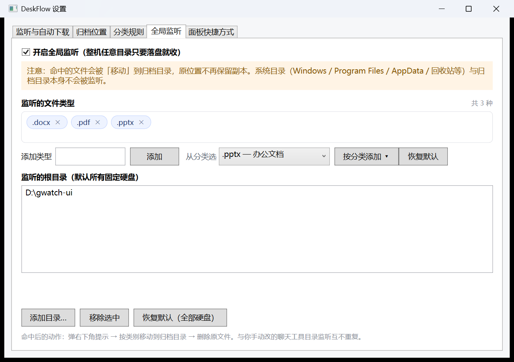

命中后：右下角弹卡片（点击可直接打开文件）→ 按类别移动到归档根目录下的类别文件夹 → 原文件被移走（同盘 move，不留副本）。

**安全边界**（写死在 `GlobalWatchFilter`，有 12 条自检用例覆盖）：

- 只处理你勾选的扩展名；0 字节、隐藏/系统/临时文件跳过；
- `~$xxx.docx`、`.tmp / .part / .crdownload` 这类半成品跳过；
- 系统目录（Windows / Program Files / ProgramData / AppData / 回收站等）永不监听；
- 归档根、配置目录、安装目录、聊天工具目录都被排除，不会自噬也不会重复归档；
- 启动时补扫最近 10 分钟落盘的文件（数量与时间都有上限），程序没开时落下的也不漏。

关掉开关即停止；已经归档的文件不会自动还原。
## 三、托盘与常驻

装好（或直接跑 EXE）之后，右下角任务栏会出现 DeskFlow 的托盘图标：蓝底白字 D。

| 托盘菜单 | 作用 |
| --- | --- |
| 打开面板 | 把面板叫回桌面（双击托盘图标同效） |
| 设置… | 打开设置窗口（监听目录 / 自动下载 / 归档位置 / 分类 / 快捷方式） |
| 自动下载 ▸ | 四个来源的开关 + 「扫描一次（近 30 分钟）」，与面板顶部勾选是同一份配置 |
| 重新启动 | 保存配置 → 起新进程 → 退出自己（改完代码/配置后不用手动关开） |
| 退出 | 真正退出：停止监听、保存配置、移除托盘图标 |

面板右上角的 `×` 现在只是**收起到托盘**（第一次会弹气泡提示），程序继续在后台按规则归档；
要彻底退出请走托盘菜单的「退出」。
## 三、安装与卸载


**双击安装包** → 选安装位置、勾开机自启/快捷方式 → 开始安装：

```
dist\TidyFlow-Setup-0.6.0.exe
```

安装界面能改的东西：

| 选项 | 说明 |
| --- | --- |
| 安装位置 | 默认 `%LOCALAPPDATA%\Programs\DeskFlow`，可改成任意目录（建议仍放用户目录，免管理员） |
| 开机自动启动 | 写 `HKCU\...\Run`，登录后自动起面板并继续按规则归档 |
| 创建桌面 / 开始菜单快捷方式 | 两个勾选相互独立 |
| 覆盖安装 | 已装过会提示原安装位置，继续则只替换程序文件，配置与归档记录保留 |

安装做四件事：复制程序 → 建快捷方式 →（可选）开机自启 → 写「设置 → 应用」里的卸载项。

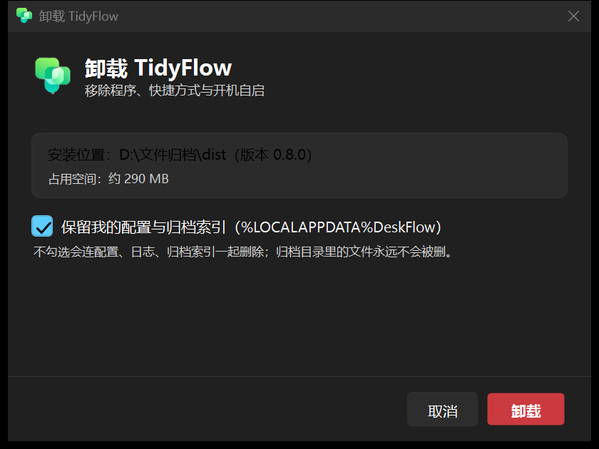

**卸载**：设置 → 应用 → DeskFlow → 卸载（或直接跑 `TidyFlow.exe --uninstall`）。
卸载界面会显示安装位置与占用空间，并给一个「保留我的配置与归档索引」勾选：

- 勾着（默认）：只删程序、快捷方式、开机自启、卸载项；配置/日志/索引留在 `%LOCALAPPDATA%\DeskFlow`，重装即接上；
- 取消勾选：连配置、日志、索引一起删；
- **归档目录里的文件永远不会被删**。

### 静默模式（批量部署 / 自动化）

```powershell
# 安装
.\TidyFlow-Setup-0.6.0.exe --install --silent --dir="D:\Apps\DeskFlow" --autostart=1 --shortcuts=1
# 卸载（保留数据）
"$env:LOCALAPPDATA\Programs\DeskFlow\TidyFlow.exe" --uninstall --silent --keepdata=1
```

退出码 0 = 成功。

### 绿色版（不安装）

```
dist\TidyFlow.exe
```

同一个 exe：不装也能直接用；文件名以 `TidyFlow-Setup` 开头或带 `--install` 时进安装模式，带 `--uninstall` 时进卸载模式。
---

## 四、数据放在哪

| 路径 | 内容 |
| --- | --- |
| `%LOCALAPPDATA%\DeskFlow\settings.json` | 监听目录、自动下载开关、归档根、自定义类别、面板快捷方式、面板坐标 |
| `%LOCALAPPDATA%\DeskFlow\archive-index.json` | 归档索引（来源 / 类别 / 落盘路径 / 状态），面板四块列表都读它 |
| `%LOCALAPPDATA%\DeskFlow\logs\*.log` | 运行日志 |
| `文档\DeskFlow\output\archive\<类别>\` | 归档后的文件本体 |

便携/测试模式：设置环境变量 `DESKFLOW_HOME` 指到任意目录，配置与索引整体搬过去，不动真实用户配置。

---

## 四、架构

```
DeskFlow.App (WPF 面板 + 设置 + 批处理窗口 + CLI)
      ↓ 引用
DeskFlow.Infrastructure   Watch(目录探测/轮询监听) · Archive(归档器) · Index(JSON 索引)
                          · Steps/Sinks(批处理能力) · Settings · Services(Shell)
      ↓ 引用
DeskFlow.Core             Models · Categorization(类别目录) · Abstractions · Runtime(JobEngine)
```

两条主线：

1. **监听归档线**：`SourceDirectoryResolver` 探出 QQ/微信/钉钉/下载目录 → `IncomingWatcher` 每 2 秒轮询、连续两轮大小不变才算写完 → `PanelViewModel.HandleDetected` 判断该来源是否自动下载 → `FileArchiver` 按 `CategoryCatalog` 落盘 → `JsonArchiveIndex` 记账 → 面板刷新。
2. **批处理线**（原有能力，保留）：`JobEngine` = 输入源 → 步骤 × N → 输出目标 → `JobReport`，命令行与「批处理」窗口共用。

硬规则：归档器只搬文件不删原件（除非显式选「移动」）；类别解析永远有兜底「其他」；索引写坏只丢历史、不崩程序。

详见 [docs/architecture.md](docs/architecture.md) 与三份 ADR。

---

## 五、加东西要改哪里

| 想要的 | 动作 |
| --- | --- |
| 支持新的聊天工具 | `SourceDirectoryResolver.Discover()` 加一条候选路径 |
| 新的内置类别 | `DefaultCategories.Create()` 加一行（用户也能在设置里自建，不必改代码） |
| 归档后动作（上传网盘、发通知） | 在 `PanelViewModel.ArchiveAndRecordAsync` 后加一步，或写新的 `IOutputSink` |
| 新的批处理步骤 | 实现 `IPipelineStep`，在 `DefaultJobCatalog.Build()` 注册一行 |
| 面板多一块（如「今天收了多少」） | `PanelViewModel` 加集合，XAML 复制一段 `ItemsControl`（模板 `TileTemplate` 与列数自适应已复用） |
| 调整密度手感 | `PanelViewModel.ApplyPanelWidth`：改 `minTileWidth`（每格最小宽）、列数上下限、字号缩放区间 |

---

## 六、用 VS Code 打开

```powershell
code D:\文件归档          # 或直接双击仓库里的 DeskFlow.code-workspace 不存在时用这条
```

已经配好了 `.vscode/`：

| 文件 | 作用 |
| --- | --- |
| `settings.json` | 排除 bin/obj/dist/.tmp、绑定 `DeskFlow.sln`、WPF/XAML 关联 |
| `tasks.json` | 任务：`build`（默认 Ctrl+Shift+B）、`run: GUI`、`run: checks`、`run: diagnose`、`pack: 单文件 EXE`、`pack: MSI` |
| `launch.json` | 三个调试目标：面板、`--diagnose` 命令行、自检程序 |
| `extensions.json` | 推荐扩展：C#（已装 v2.160.4）、C# Dev Kit、PowerShell |

首次打开如果右下角提示 "C# Dev Kit" 或 "需要还原项目"，点允许即可；
`dotnet` 会自己 restore，之后 `Program.cs` / `*.xaml` 都有智能提示与跳转。

> WPF 的界面调试：在 `DesktopPanelWindow.xaml` 里打断点，按 F5 选「调试 DeskFlow 面板」。
> 注意面板是常驻窗口，调试时可以先在 `App.OnStartup` 里加断点看启动流程。

## 七、构建与自检

需要 .NET SDK 10（本机 10.0.401）。

```powershell
dotnet build DeskFlow.sln
dotnet run --project tests\DeskFlow.Checks      # 75 项零依赖自检
powershell -File build\pack.ps1                # 单文件 EXE → dist\（约 59 MB，自包含）
```

自检覆盖：类别解析与同名并集、归档落盘/判重/改名/移动、监听「写完才报」与去重、索引持久化、设置读写、面板命中（拖动/缩放/顶住）、目录探测（重定向文档 + QQ/微信 3.x/4.x/钉钉布局 + 噪声过滤），以及原有批处理链路。

---

## 八、已知边界

- 监听依赖**客户端默认收文件目录**；若你把文件另存到了别处，用设置里的「自动查找数据目录…」扫盘，或手动添加。
- 目录探测走 `Environment.SpecialFolder.MyDocuments`（跟着"文档"重定向走），不是写死的 `%USERPROFILE%\Documents` —— 后者在把文档挪到 D 盘的机器上一定是空的。
- 客户端装了就一定会出现在面板上：目录还没被创建（还没收到过文件）时显示「等待首次接收」，目录一出现监听立即生效，不用重启。
- 聊天工具目录里的缩略图/表情/日志/数据库缓存会被过滤掉，不会刷屏（`IncomingWatcher.IsNoise`）；启动补扫也走同一套过滤。
- **"发出去的文件"不会在本机落盘**：QQ/微信里发送是上传，只有"接收方/自己下载保存"时才会写进收文件目录。
  所以自测时要在客户端里点一下那个文件让它下载，或让对方发给你。
- QQ 的监听范围是 `<账号>\nt_qq\nt_data` 整棵子树（收文件可能落在 `File\Ori`、`File\FileRecv`、`dataline` 等不同子目录），只盯一个子目录会漏。
- 判重用「长度 + 首 1 MB SHA-256」，不是全文件哈希：几万文件量级够快；同名、同首块但尾部不同的极端情况会走改名 `(2)` 而不是判重。
- 面板按内容自适应高度，超过屏幕工作区后内部滚动；不抢焦点、默认不置顶。
- `dist\` 不进 Git（59 MB 二进制），发版走 Releases。

## 九、已修复的坑（记在这免得再踩）

| 现象 | 根因 | 修法 |
| --- | --- | --- |
| 最小化再打开，面板内容全没了 | `AllowsTransparency=True` 的分层窗口在 Windows 上会丢失合成表面，还原后不重绘 | 改成非分层窗口 + `WindowChrome` + DWM 圆角（`RoundedCorners`）；另外在 `OnStateChanged` 里强制重绘，且最小化期间不把 0 尺寸写进配置 |
| 三个客户端全显示「未检测到目录」 | 探测用死了 `%USERPROFILE%\Documents`，而本机「文档」重定向到了 `D:\docu` | 改用 `SpecialFolder.MyDocuments`；补 QQNT 9.x 的 `nt_qq\nt_data\File`、微信 4.x 的 `msg\file`、钉钉 `DingTalk\<用户>\file`；再加 3 层兜底扫盘 |
| 面板里刷出一堆 .db / 缩略图 | QQ 会把 Thumb/Emoji/log/db 都写在收文件目录旁 | 监听器按路径段过滤噪声目录 |

## 十、下一步候选

- [ ] 托盘图标 + 开机自启 + 全局热键唤起
- [ ] 归档后清理重复文件、按月份/来源建二级目录
- [ ] 分类内文件列表页、面板中键滚动
- [ ] 归档动作插件化（webhook / 网盘 / 备份盘）

## 十一、界面：Windows 11 风格

整套 UI 按 **Windows 11 / WinUI 3** 的规范重做，令牌集中在 `src/DeskFlow.App/Themes/Design.xaml`：


| 项目 | 取值（WinUI dark） |
| --- | --- |
| 层次底色 | 窗口 `#202020` · 卡片 `#2C2C2C` · 控件填充 rgba(255,255,255,0.06) |
| 描边 | 控件 8% 白、卡片 7% 白，1px；不靠阴影分层 |
| 圆角 | 控件 4px、卡片/窗口 8px |
| 字体 | Segoe UI Variable Text（回退 Segoe UI / 微软雅黑 UI） |
| 字号 | 标题 20 / 正文 14 / 说明 12 |
| 强调色 | `#60CDFF`（深色主题的浅蓝），强调按钮是浅蓝底 + **黑字** |
| 控件 | 复选框 20px 圆角方块、文本框 4px 圆角 + 聚焦底部强调线、滚动条 6px、开关 ToggleSwitch |

**设置窗口**改成 Win11 的左侧导航（NavigationView）：导航项带图标、选中项有 3px 强调色指示条，右侧内容卡片分组。

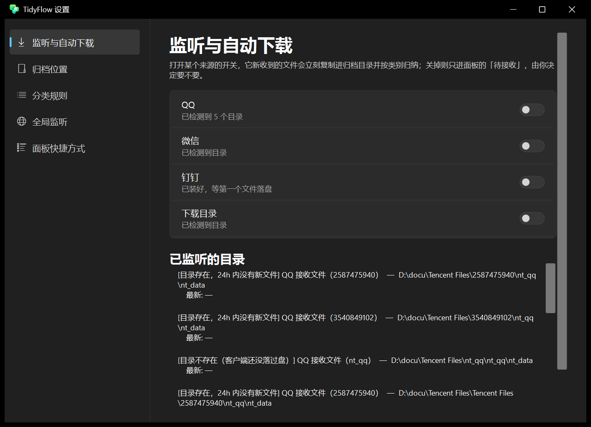

**归档记录**、**安装**、**卸载** 三处共用同一套令牌：

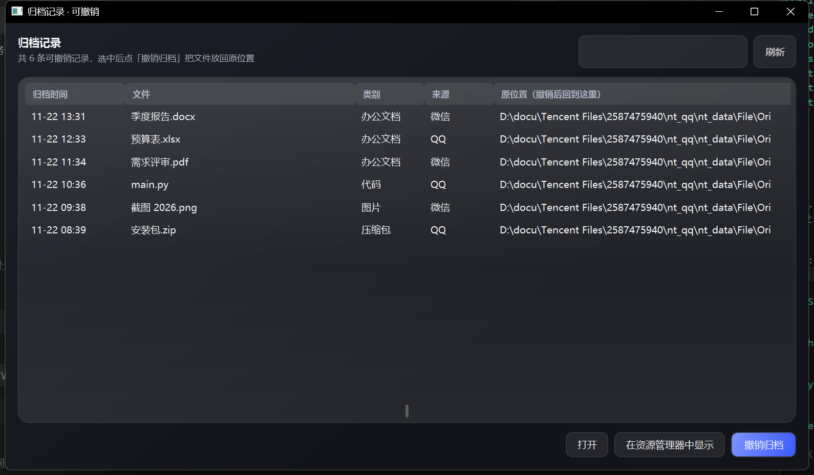


关于云母（Mica）：仍然会尝试调用 DWM 的 `DWMWA_SYSTEMBACKDROP_TYPE`，
但**底衬永远是 Win11 的 `#202020` 实色**——WPF 里让系统材质透出来需要把窗口背景设透明，
实测会导致内容区不重绘（露出背后的程序），比不生效更糟。所以材质只是锦上添花。

### 拖拽收录：拖到哪个分类就进哪个分类

从资源管理器（或桌面）把文件直接拖进面板：

| 拖到哪 | 结果 |
| --- | --- |
| 某个分类（如「办公文档」） | 归到该分类目录，**不看扩展名** |
| 面板空白处 | 按扩展名自动分类 |
| 拖拽时按住 **Shift** | 移动（原件消失） |
| 直接拖（不按 Shift） | 复制（原件保留），和资源管理器一致 |

拖到分类上时，被选中的分类瓦片会亮起强调色边框；松手后右下角会提示「已收录 N 个文件 → 放进了「办公文档」（复制）」。
一次拖多个文件、拖整个文件夹（取该目录下最多 50 个文件）都可以。

### 面板排版：图标区靠左

「应用与快捷方式 / 最近归档 / 分类」三个分区的图标与文字统一**左对齐**，和分区标题对齐在一条竖线上；
标题栏把「归档记录 / 设置 / 扫描磁盘」收进 **⋯** 菜单，只留 顶住 / ⋯ / 收起 / 关闭 四个按钮，窄面板标题不再被挤。

设置窗口按 Win11「设置」应用的样子排：

| 区域 | 做法 |
| --- | --- |
| 左侧导航 | 232px 宽、40px 行高、图标 + 文字，选中项圆角填充 + 3px 强调色竖条 |
| 页面标题 | 28px SemiBold，下面一行说明文字（对应 Win11 的「个性化 › 任务栏」这种标题区） |
| 设置行 | 卡片里一行一项：左侧标题 + 说明，右侧 Win11 开关（ToggleSwitch），行间 1px 分隔线 |
| 内容留白 | 左右 30px、上下 22px，与 Win11 设置一致 |

### 面板：一级 / 二级导航


面板内部改成「导航 + 内容」两栏，和 Windows 11 设置同一套结构：

| 层级 | 条目 |
| --- | --- |
| 一级 | **应用与快捷方式**、**最近归档** |
| 分组 | **分类**（标题行，不可点） |
| 二级 | 分类下的「办公文档」「图片」「压缩包」…，点一下右侧就列出该分类的文件 |

选中项带圆角填充，二级条目缩进 14px；右侧内容随选择切换，文件行支持单击打开、右键定位。
拖拽收录不受影响——把文件拖到左侧某个分类上，照样收进那个分类。

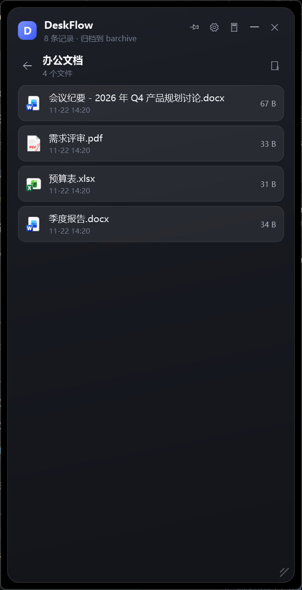

### 导航是两级页，不是展开项

左栏只放一级：**应用与快捷方式**、**最近归档**、**分类**。点「分类」不是在上面展开，而是**整栏切换到二级页**——顶部一个返回箭头，下面是分类清单，右侧内容区跟着显示对应文件。

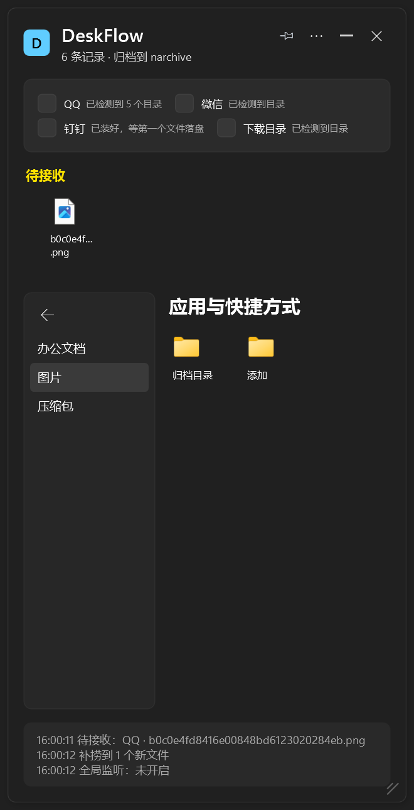

导航栏高度**跟随窗口**：它占满「来源开关」和日志之间的整段高度（`VerticalAlignment=Stretch` + 中间行 `Height=*`，最小 220px），面板拉高、拉宽都跟着变；窗口高度不足时中间那行至少保留 220px，不会把导航压没。

## 十三、品牌：TidyFlow


软件名从 DeskFlow 改成 **TidyFlow**，图标换成绿色叠片（4 个圆角方块 + 泪滴形，见上图）。

| 项目 | 变化 |
| --- | --- |
| 可执行文件 | TidyFlow.exe（安装包 TidyFlow-Setup-0.8.0.exe） |
| 程序集 / 产品名 | TidyFlow（窗口标题、托盘提示、卸载项名称同步） |
| 图标 | Assets/tidyflow.ico（16/24/32/48/64/128/256 七个尺寸，PNG 压缩帧） |
| 安装目录 | %LOCALAPPDATA%\Programs\TidyFlow |
| 配置与索引 | 仍然是 %LOCALAPPDATA%\DeskFlow —— **故意没改**，否则老用户的设置和归档索引会丢 |

图标源文件放在 src/DeskFlow.App/Assets/：tidyflow-source.img（原始图）、appicon-256.png、icon-*.png、tidyflow.ico。

### 待接收文件可以先预览再决定

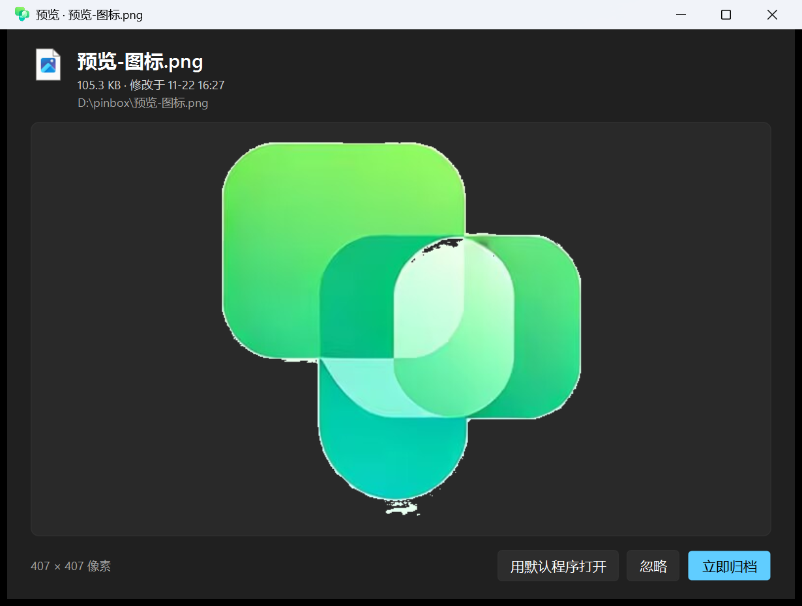

点面板「待接收」里的任意文件，弹的是**预览窗口**（不再是点了就直接吞进分类目录）：

| 内容 | 预览方式 |
| --- | --- |
| 图片 png / jpg / gif / bmp / webp / ico / tif | 直接显示，底部标注像素尺寸 |
| 文本 txt / md / log / json / xml / csv / 代码… | 等宽字体显示前 **200 KB** |
| 其它（pdf / docx / zip …） | 显示文件信息 + 提示用默认程序打开 |

窗口底部三个动作：**用默认程序打开** / **忽略** / **立即归档**（归档后自动关闭并刷新面板）。
右键菜单里也有「预览」，和左键一致。

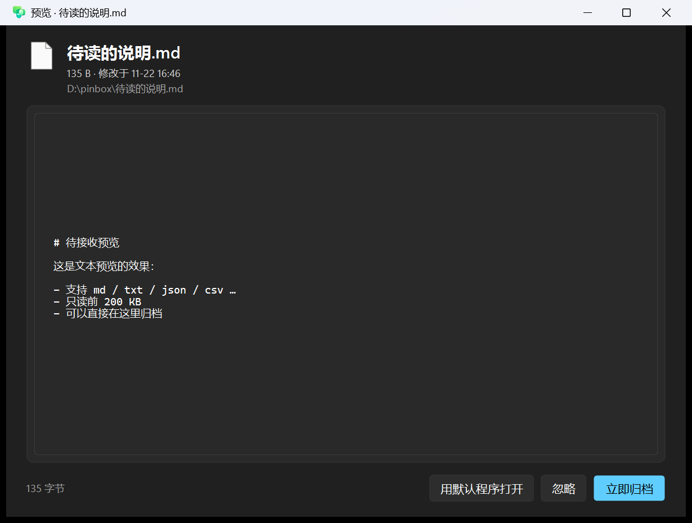

命令行也能直接预览：`TidyFlow.exe --preview <文件路径>`（方便做成「用 TidyFlow 预览」的右键菜单项）。

### 默认窗口尺寸

首次打开是 **960 × 800**（窗口比例约 6:5），正好放下「左侧导航 + 右侧内容」两栏；窗口可自由拉伸，位置和尺寸会记住。

老版本存下来的窗口偏窄（宽度 < 800）会**一次性**迁移到新默认值，之后你手动拖过的尺寸不会再被覆盖；迁移标记写在 settings.json 的 panel.layout.v2。

## 十五、按文件内容自动分类（内置，离线）

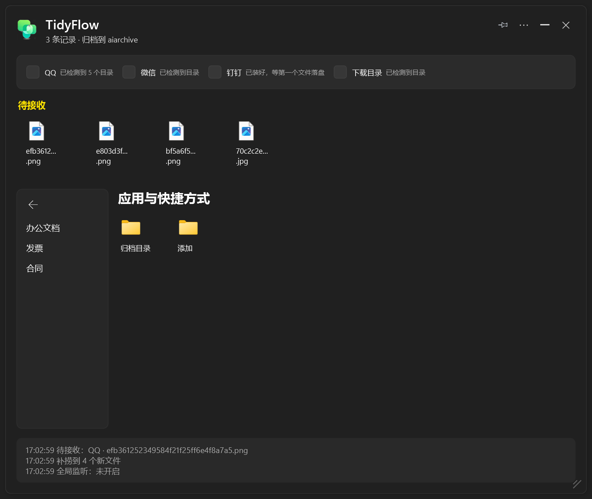

归档时不只看扩展名，会**读文件正文**判断该进哪个类别；类别不存在就**现场建目录**，并立刻出现在左侧「分类 → 二级菜单」里。

| 格式 | 取正文的方式 |
| --- | --- |
| .docx / .xlsx / .pptx | 解压 zip，读 `word/document.xml`、`xl/sharedStrings.xml`、`ppt/slides/*.xml` 再剥标签 |
| .pdf | 取 `(…)Tj` 字面量（中文多为编码字形，抽不到就退回文件名关键词） |
| .txt/.md/.csv/.json/.log/代码 | 直接读前 256 KB |

判定方式是**加权关键词打分**（完全离线，不联网、不需要模型文件）：

| 类别 | 命中词示例 |
| --- | --- |
| 发票 | 增值税、价税合计、开票日期、纳税人识别号 |
| 合同 | 甲方、乙方、违约责任、签署、agreement |
| 简历 | 教育经历、工作经历、求职、resume |
| 会议纪要 | 会议纪要、参会人员、议程、决议 |
| 财务 | 预算、决算、资产负债表、应收应付 |
| 报告 / 代码 / 演示文稿 / 表格数据 / 说明书 | 相应关键词组 |

分数低于阈值就**不硬猜**，交回扩展名规则；命中后会记录依据，面板日志里能看到 `（内容识别（发票、价税合计））`。

开关在 设置 → 归档位置 → **按文件内容自动分类**（默认开）；关掉就完全按扩展名。

命令行也能按同一套规则归档一次：TidyFlow.exe --import <文件或目录>

## 十六、扫描磁盘

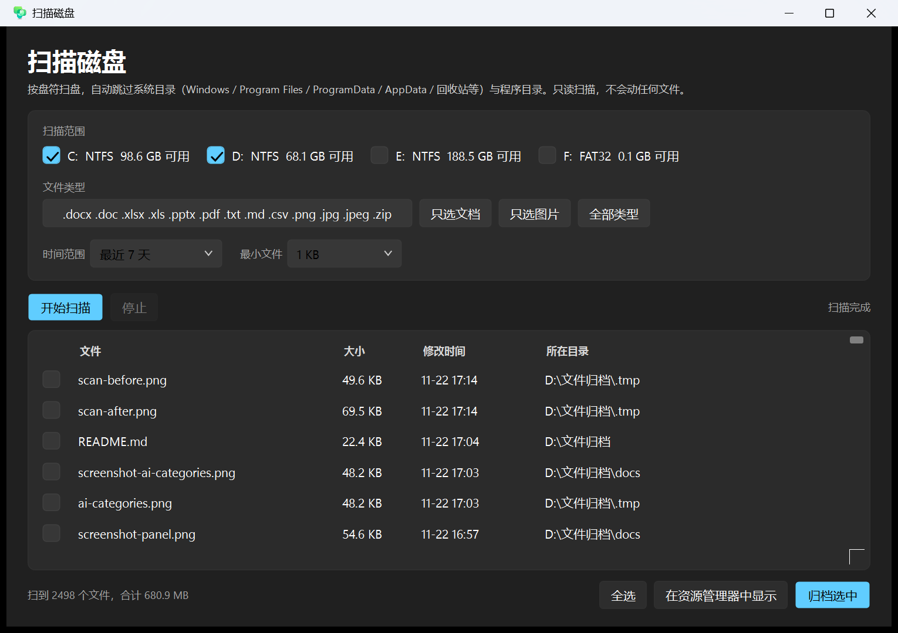

入口：面板右上角 **⋯ → 扫描磁盘…**，或 TidyFlow.exe --scan。

| 条件 | 说明 |
| --- | --- |
| 扫描范围 | 勾系统里的各个盘（显示文件系统与剩余空间），可多选 |
| 文件类型 | 自己填扩展名（空格分隔），或点「只选文档 / 只选图片 / 全部类型」 |
| 时间范围 | 不限 / 最近 1、7、30、90 天 / 最近一年（按修改时间） |
| 最小文件 | 1 KB / 100 KB / 1 MB / 10 MB，过滤缩略图这类噪音 |

**自动跳过**：Windows、Program Files (x86)、ProgramData、AppData、$Recycle.Bin、System Volume Information、WinSxS、node_modules、obj/bin 等系统与程序目录；
另外还跳过 **junction / 符号链接**（否则 `All Users`、`Documents and Settings` 这类重定向会把同一目录重复扫很多遍）、隐藏与系统属性文件。
归档目录自身和 TidyFlow 的配置目录也排除在外，避免扫到自己刚归档的东西。

扫描是**只读**的，不会动任何文件；结果按修改时间倒序，列显示文件 / 大小 / 修改时间 / 所在目录，可 Ctrl 多选或勾选，
底部「归档选中」会走和拖拽/聊天监听同一套流程（默认复制、按内容自动分类），归档后从列表里移除。

实测（C: + D: 两个盘、最近 7 天、默认文档+图片类型）：**2498 个文件 / 680.9 MB**，扫描过程中实时显示已进目录数与匹配数，随时可「停止」。

### 扫描卡退修复（0.8.1）

第一版「开始扫描」在真机上一按就卡退，原因两个，都跟扫描逻辑本身无关：

| 问题 | 现象 | 修法 |
| --- | --- | --- |
| 进度回调太密 | 每进 40 个目录就 `Report` 一次，整盘扫描几万次回调全砸到 UI 线程，界面直接假死 | 改成**最多每 250ms 报一次** |
| 结果逐条 Add | 5000 条结果逐条 `ObservableCollection.Add`，触发 5000 次 `CollectionChanged`，ListView 每次重排 | 改成**一次性赋值** ItemsSource |

另外补了三层兜底：单目录/单文件异常一律跳过（不再只挡 IO/权限）、盘符枚举包 try、目录数上限 30 万，
并新增 **crash.log**（`%LOCALAPPDATA%\DeskFlow\crash.log`），任何未处理异常都会连堆栈写进去。

压测结果（C: + D:、全部类型、5000 条上限）：60 秒内进程 **始终 responding**，内存稳定在 250–258 MB，无 crash.log。

### 安装进度

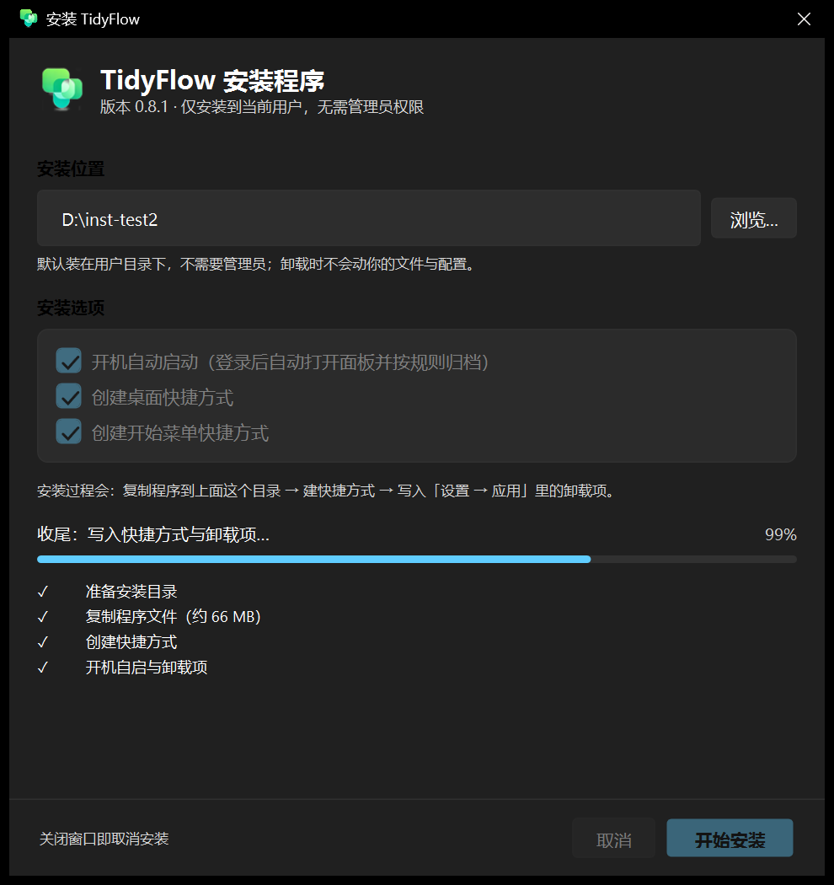

点「开始安装」后，界面会出现：

- **进度条**：Win11 圆角样式，准备阶段走不确定态（跑马灯），开始复制后变成平滑推进（260ms 缓动到新值）；
- **百分比 + 当前动作**：准备安装目录 → 复制程序文件（约 66 MB）→ 创建快捷方式 → 开机自启与卸载项；
- **四步清单**：`○ 未开始` / `● 进行中` / `✓ 已完成`，逐项点亮；
- 安装期间所有输入控件禁用，完成后按钮变成「启动 TidyFlow」。

SSD 上 66 MB 复制不到 200ms，进度一闪而过，所以加了**最短 1.2 秒可见时长**：真实结果先返回，界面把进度滚到 100% 再收尾（不是假装在装）。

## 十七、性能优化（0.8.2）

「整体卡顿」查到三个真因，逐个修掉并做了实测：

| 问题 | 影响 | 修法 | 实测 |
| --- | --- | --- | --- |
| 面板根节点用了 `DropShadowEffect` | WPF 里给可视树加 Effect 会让**整个窗口退回软件渲染**，滚动/缩放全掉帧 | 去掉效果，分层交给 1px 描边 + DWM 阴影 | 渲染层级回到 **Tier 2（硬件加速）** |
| 拖拽缩放时每帧都重建四个列表 | 每来个 `SizeChanged` 就 `Clear` + 逐条 `Add`，几十个格子重建一遍 | **90ms 防抖** + 宽度变化 <2px 忽略 + **原位改瓦片尺寸**（瓦片支持属性通知，不再重建集合） | 30 次连续改宽度 → 只重排 **2 次**，每次 **0.5–0.8ms** |
| 扫描/归档列表几千行 | 滚动时不断创建/销毁行容器 | `VirtualizingPanel.VirtualizationMode=Recycling` + 像素滚动 + 延迟滚动 | 5000 行滚动不再掉帧 |

另外顺手：图标按扩展名缓存并 `Freeze()`（已在上一版）、日志只保留最近 200 条、状态栏只显示最近 3 行。

空闲占用实测：面板常驻、两份监听目录在跑，**10 秒内 CPU 约 0.42%（单核百分比）**，内存 250 MB 左右。

### 安装闪退修复（0.8.3）

症状：点「开始安装」窗口直接消失。根因与修法：

| 问题 | 说明 |
| --- | --- |
| async void 里漏出的异常 | 安装逻辑在 Task.Run 里抛的任何异常都会从 await 冒出来，async void 捕获不到 → 整个进程结束（没有任何提示，就是闪退） |
| 只用 dynamic 调 WScript.Shell | 快捷方式那段用 C# 动态绑定，部分机器会抛 RuntimeBinderException / COMException，恰好不在原来的异常过滤名单里 |
| 异常过滤太窄 | 原来只 catch IOException / UnauthorizedAccessException / ArgumentException，其余直接上抛 |

现在：快捷方式改成反射调用（不依赖 C# 绑定器）、Install/Uninstall 改成 catch (Exception) 并归类成可读文案、界面里的 await 也包了 try/catch —— 失败只会显示一行红字，不会再退出。

失败会写 %LOCALAPPDATA%\DeskFlow\install.log（含完整堆栈），以后再遇到问题直接看这个文件。

## 十八、空格快速预览

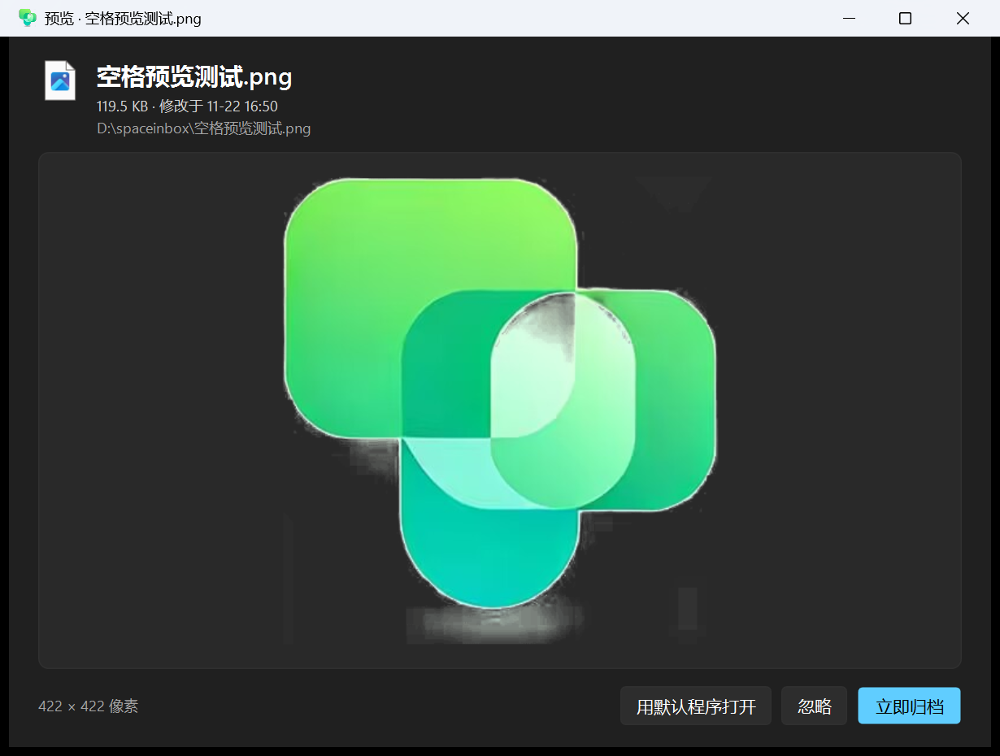

**把鼠标放到文件上，按一下空格**，直接弹预览 —— 不用点、不用双击，和 macOS 的 Quick Look 一样。

| 悬停在哪 | 空格做什么 |
| --- | --- |
| 待接收的图标 | 完整预览（底部有「用默认程序打开 / 忽略 / 立即归档」） |
| 分类列表里的文件行 | 只读预览（只留「用默认程序打开」） |
| 最近归档的图标 | 只读预览 |

实现上用的是 **WH_KEYBOARD_LL 全局键盘钩子**：只在**鼠标位于面板上**时才拦空格，这样不用先点一下面板拿焦点；
钩子里只做判断并把弹窗投递到 UI 线程，不会卡输入。空格被吃掉时不会触发下面的按钮或滚动。

开关在 设置 → **面板快捷方式** → 「空格键快速预览（鼠标悬停文件后按空格）」，默认开。

### 拖到面板任意位置都能收

以前拖放只挂在窗口的 XAML 属性上，拖到 **左侧导航 / 内容区空白处** 时事件会被子控件吞掉，表现就是“拖到中间那片没反应”。

现在改成在窗口上 `AddHandler(..., handledEventsToo: true)` 捕获 **DragOver / DragLeave / Drop**，所以：

| 拖到哪 | 结果 |
| --- | --- |
| 某个分类图标上 | 收进那个分类（不看扩展名） |
| 任意空白处 / 导航栏 / 日志区 / 标题栏 | 自动分类：先按内容识别，判不出来按扩展名 |
| 拖动过程中 | 面板边框变成强调色，明确“松手就收” |
| 按住 Shift | 移动（原件删除），否则复制 |

实测：把一份含“增值税专用发票 / 价税合计”的 docx 拖到**左侧导航栏上方**（原来完全没反应的位置）：

```
drop: paths=1 tile=none category=(auto) move=False
→ D:\darchive3\发票\拖进来的发票.docx
```

### 内容分类准确率改造（0.8.6）

旧版的问题：关键词不分轻重、门槛太低、只读半份正文，结果就是**经常硬猜错**。现在换成加权 + 宁可放弃的模型：

| 维度 | 旧版 | 新版 |
| --- | --- | --- |
| 关键词 | 一律 2 分，出现就加 | **强证据 5~7 分**（增值税、违约责任、教育经历）、中等 3~4、泛词 1~2 |
| 判定门槛 | 3 分（一个泛词就过关） | 每类 8~10 分，且**最高分 ≥ 第二名 1.5 倍**，否则放弃 |
| 文件名 | 命中 +3 | 按词权重减半加分（名字里写“合同”确实可信） |
| 文件类型 | 不参与 | `.xlsx` 不可能进「简历/合同/会议纪要」，`.pptx` 只按演示文稿判 |
| 正文抽取 | 只读 document.xml / sharedStrings / 前 2 页幻灯片 | **全部 XML**（页眉页脚、脚注、所有幻灯片）+ `docProps/core.xml` 标题关键词 |
| 类别覆盖 | 9 类 | 11 类（新增**学习资料**、**通知公告**） |
| 扩展名兜底 | 全部进「办公文档」 | 拆出**表格**（xls/xlsx/csv）、**演示文稿**（ppt/pptx） |

**准确率回归测试**：内置 15 条带标准答案的样本（发票/合同/简历/会议纪要/财务/报告/代码/演示文稿/说明书/学习资料/通知公告），
外加 2 条“故意模糊”的样本要求**必须放弃判定**：

```
准确率 ≥ 90%（实测 100%，15/15）
放弃判定：模糊内容 ✓   放弃判定：无特征内容 ✓
```

实测你机器上的真实文件：

```
全国大学英语四六级口语考试考前通知.docx → 学习资料（内容识别 11 分：考试）
曾学槐Excel实验2.xlsx                    → 表格（扩展名规则）
修身为本.docx                            → 办公文档（内容判不准 → 按扩展名）
```

第三行是关键：**判不准就老实用扩展名，不瞎猜**。想自己验证某个文件的判定依据：

```
TidyFlow.exe --classify <文件或目录>
```

### 判不出来 → 「未识别」

文档类文件（docx / xlsx / pptx / pdf / txt / md / csv / 代码…）如果内容判不出类别，会进 **未识别** 目录，而不是硬塞进“办公文档”：

| 情况 | 结果 |
| --- | --- |
| 内容识别命中 | 进对应类别（发票/合同/简历…） |
| 内容判不出来（文档类） | **未识别**，目录自动创建并出现在分类导航 |
| 图片 / 压缩包 / 安装包 / 音视频 | 仍按扩展名分类，不受影响 |
| 关掉开关（设置 → 归档位置） | 退回按扩展名分类 |

记录里会写原因：`内容识别失败（未能判断类别）`。命令行验证：

```
TidyFlow.exe --import 随手记.docx
# → 随手记.docx → 未识别（内容识别失败（未能判断类别））
```

### 待接收可以多选了

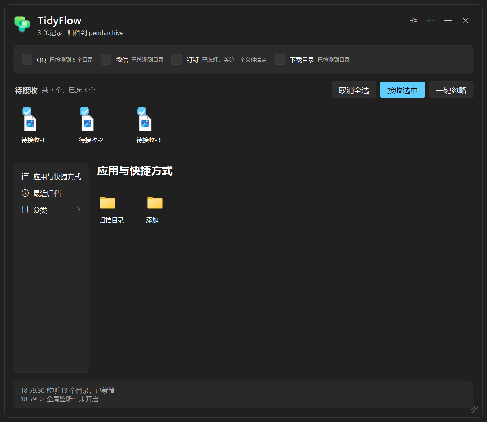

待接收区标题右边有三个按钮，每个图标左上角有勾选框：

| 操作 | 效果 |
| --- | --- |
| 勾选框 / 全选 | 多选待接收文件（勾选不会触发预览） |
| 接收选中 | 把勾选的文件批量归档（走和单条相同的分类流程，含内容识别） |
| 一键忽略 | 把当前所有待接收一次性标记为「忽略」，不再出现在列表里 |

标题会实时显示 `共 N 个，已选 M 个`；「接收选中」在没勾选时是灰的。

### 格子内容统一居中（0.8.10）

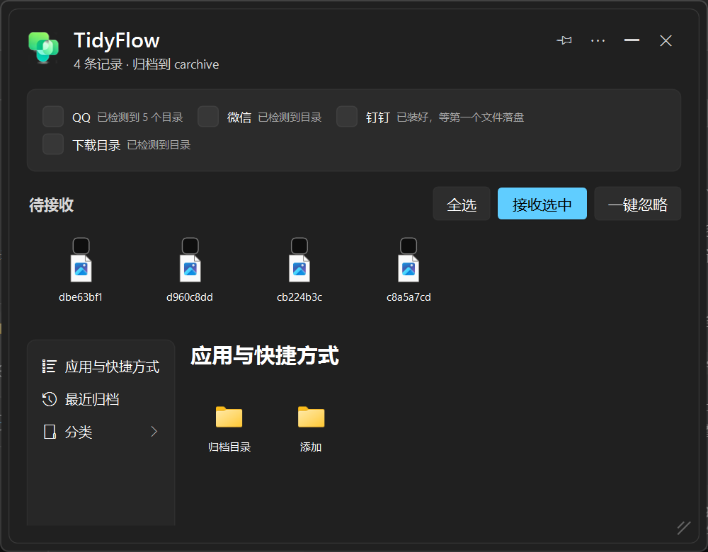

待接收的勾选框、文件图标、文件名/副标题现在共用同一条中轴；分区本身仍然从左侧开始排布。

用 UIA 实测（同一列）：`按钮中线 423 · 勾选框 422.5 · 图标 423 · 文字 423`——误差 ≤0.5px。


## 怎么确认自己跑的是哪一版

点右上角 **⋯**，菜单第一行就是版本号（例：`TidyFlow 0.8.11`）。

Windows 上常见一个坑：托盘里还挂着旧进程，双击 exe 只是唤醒它，看到的仍是旧界面。**升级后请先在托盘右键 →「退出」**，再运行新 exe / 安装包。


### 待接收瓦片的排布（0.8.12）

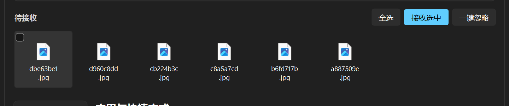

- **图标、文件名、副标题**：以格子中线对齐（居中）；
- **勾选框**：固定在格子**左上角**，和悬停底色左上角对齐，位置稳定不随文件名长短跳动。

UIA 实测：格子左边 341 · 勾选框左边 343（距边 2px）· 图标/文字中线均为 423。


### 勾选框只在悬停时出现（0.8.13）

平时： | 悬停在某一格：
--- | ---
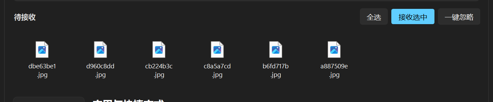 | 

- 鼠标停在哪一格，那一格左上角才出现勾选框；
- 已经勾选的格子**一直显示**勾选框（否则选完就看不见自己选了什么）；
- 悬停格子同时会亮起底色，两种状态可以叠加。


## 动效（0.9.0）

只做刚刚好的动效，不加噱头：

| 位置 | 效果 |
| --- | --- |
| 打开面板 | 淡入 + 从下方 10px 滑入（200ms） |
| 切换分区 / 进入分类 | 内容区淡入 + 8px 滑入（170ms） |
| 鼠标停到待接收文件 | 勾选框缩放弹出（0.6→1 + 回弹，140ms） |
| 设置 / 归档记录 / 扫描 / 预览 / 安装窗口 | 淡入 + 6px 滑入（160ms） |

技术上只动 Opacity / TranslateTransform / ScaleTransform —— 这三样走合成层，不触发布局重算；也刻意没用 DropShadowEffect 这类会拖慢渲染的写法。

设置 → 面板快捷方式 → 「界面动画」可以整体关掉（ui.animations，默认开），关掉后所有过渡变成瞬切。


## 导航右键：自己加内容（0.9.1）

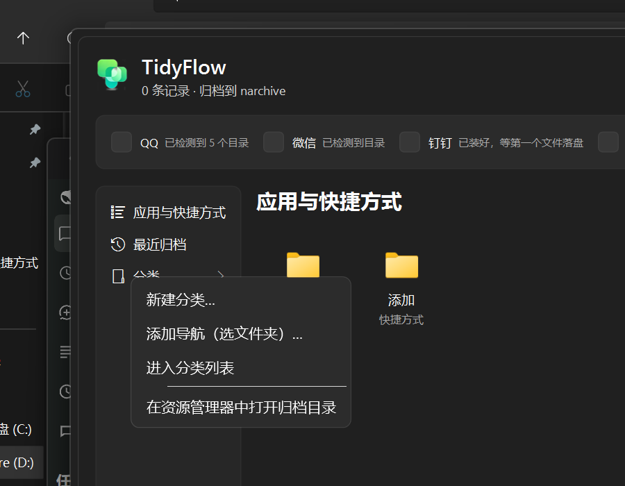

| 在哪右键 | 能做什么 |
| --- | --- |
| 左侧一级导航 | 新建分类… / 添加导航（选文件夹）… / 进入分类列表 / 打开归档目录；自定义项还能「移除导航」 |
| 二级分类列表 | 新建分类…；单个分类：重命名… / 删除（只删规则）/ 打开该分类文件夹 |

要点：

- 右键**不会跳到别的页面**（在 Preview 阶段拦截，避免误触发导航）；
- 新建分类会立刻在归档根建同名文件夹，并在分类列表出现；
- 重命名只对自建分类有效，会同步改磁盘目录名；删除只删规则，已归档文件不受影响；
- 「添加导航」可以把你常用的任意文件夹（比如桌面、某个项目目录）固定到一级导航，点开就是文件列表。


## 归档目录不再被快捷方式挤掉（0.9.2）

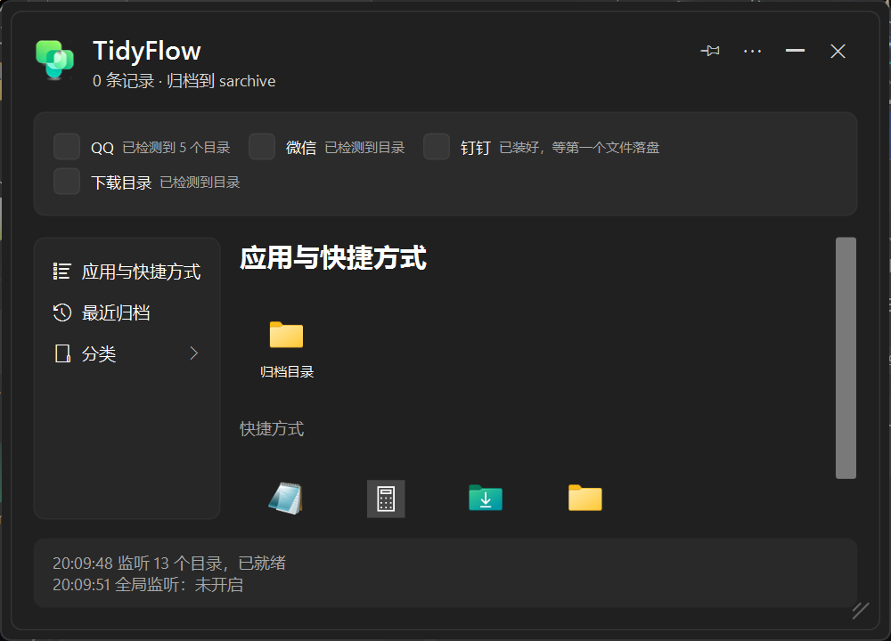

以前「归档目录」是**种子快捷方式**，只在你没有任何快捷方式时才出现——你随手加一个程序，它就没了。

现在分成两块：

| 区块 | 内容 |
| --- | --- |
| 固定位置（无标题，永远在顶部） | 归档目录（点击进入归档根） |
| 快捷方式（有小标题） | 你添加的程序/文件夹 + 末尾的「添加」 |

固定行由 `SystemPlaces` 维护，跟着面板宽度重排，和用户快捷方式互不影响。


## 更多动效（0.9.3）

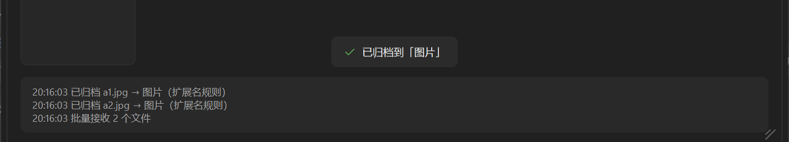

| 场景 | 动画 |
| --- | --- |
| 进入分类 / 文件列表 | 内容从**右侧**滑入 26px + 淡入（190ms） |
| 返回上一层 | 内容从**左侧**滑入（190ms） |
| 同级分区切换 | 上浮 8px + 淡入（170ms） |
| 新建分类 / 预览对话框 | 缩放 0.94→1 + 淡入（160ms） |
| 归档 / 忽略 / 撤销 / 删除 / 新建分类完成 | **底部中央弹出确认卡片**：成功是绿色 ✓，失败是红色 ✗，1.2 秒后自动淡出 |

确认卡片走的是 `PanelViewModel.Confirmed` 事件，不解析日志文本；所有过渡同样只动 Opacity / Translate / Scale。


## 移除了「批量文件盘点与报表」窗口（0.9.4）

这个窗口是早期命令行盘点工具的可视化壳：白底、Win32 风格，和现在的 Win11 深色界面完全不搭，功能也与面板里的「扫描磁盘」重叠，所以整个删掉了（含 ⋯ 菜单里的入口）。

底层命令行盘点仍可用（给脚本/批处理用，不出界面）：

```
TidyFlow.exe --run <目录> --out <输出目录>
```


## 设置窗口白屏修复（0.9.5）

现象：打开设置/归档记录/扫描/安装窗口时，只剩一个纯白窗口，什么都没有。

原因：0.9.0 给窗口加了"淡入 + 上移"动画，但 WPF 的 `Window` **不允许设置 RenderTransform**，直接抛：

```
System.InvalidOperationException: Transform is not valid for Window.
   at DeskFlow.App.Services.Animations.FadeSlideIn(...)
   at DeskFlow.App.SettingsWindow.<.ctor>b__4_0(...)
```

异常发生在 `Loaded` 里，WPF 已经把窗口框架画出来了、内容还没渲染，于是就是白屏 + 一条 crash.log。

修法：`Animations` 检测到目标是 `Window` 时，动画自动改作用到它的 **Content** 元素上；并且三个动画方法都包了 try/catch，动画失败也只会"瞬显"，不会让界面白屏。


## 收起不再是空白卡片（0.9.6）

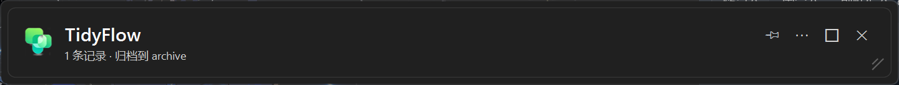

现象：点标题栏的「—」收起，窗口变成一块**空白深色卡片**，连标题都没了。

两个原因叠在一起：

1. 收起时把整块 `BodyScroller` 隐藏了，而**标题栏就在这块里面**，所以连 Logo 和按钮一起消失；
2. `Height = 60` 被 `MinHeight = 380` 顶回去，窗口实际仍是 380 高 → 一块大空白。

现在的做法：

- 只隐藏「标题以下的分区」（`Grid.Row > 0` 的行），标题栏始终保留；
- 收起前先把 `MinHeight` 放到 92，再设高度，收起后是一条 92px 的标题条；
- 展开时恢复原高度并把 `MinHeight` 复位到 380，随后强制重排/重绘一次，内容立刻回来。


## 拖进来的快捷方式不归档（0.9.7）

把 **.lnk / .url** 拖到面板上（应用与快捷方式区域或任意位置），它不会像普通文件那样被分类归档，而是**直接变成面板上的快捷方式图标**：

| 拖入内容 | 结果 |
| --- | --- |
| `.lnk` / `.url` | 登记为面板快捷方式（名字取文件名去掉扩展名），归档目录**一个文件都不增加** |
| 普通文件 | 照旧按落点分类归档 |
| 混合拖入 | 快捷方式进面板，其余文件归档 |

实现上先按扩展名分流（`ShortcutKinds.IsShortcut`），快捷方式走 `ShortcutRegistry.Add`（去重、写 `panel.shortcuts`），其余文件走 `ImportDroppedAsync`。

> 调试钩子：设置环境变量 `DESKFLOW_AUTODROP="路径1|路径2"` 后启动，面板会按同一套分流规则处理这些路径，用于回归验证。


## 二级菜单的「新建 / 删除」（0.9.8）

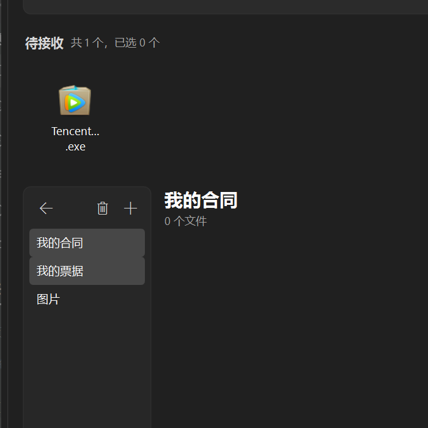

进「分类」后，左栏顶部多了三个按钮：

| 按钮 | 作用 |
| --- | --- |
| ← | 返回一级导航 |
| 🗑 | **删除选中的分类**（支持 Ctrl / Shift 多选） |
| ＋ | 新建分类（和右键「新建分类…」同一个入口） |

细节：

- 列表开了 `SelectionMode=Extended`，Ctrl 点选、Shift 连选都行；**选中 2 个以上时不会自动跳进某个分类**，方便批量操作；
- 删除只移除分类规则，**磁盘上已归档的文件保持原样**；内置分类（办公文档/表格/代码/图片…）会自动跳过并在结果里说明；
- 选中多项时工具条会显示「已选 N」。
