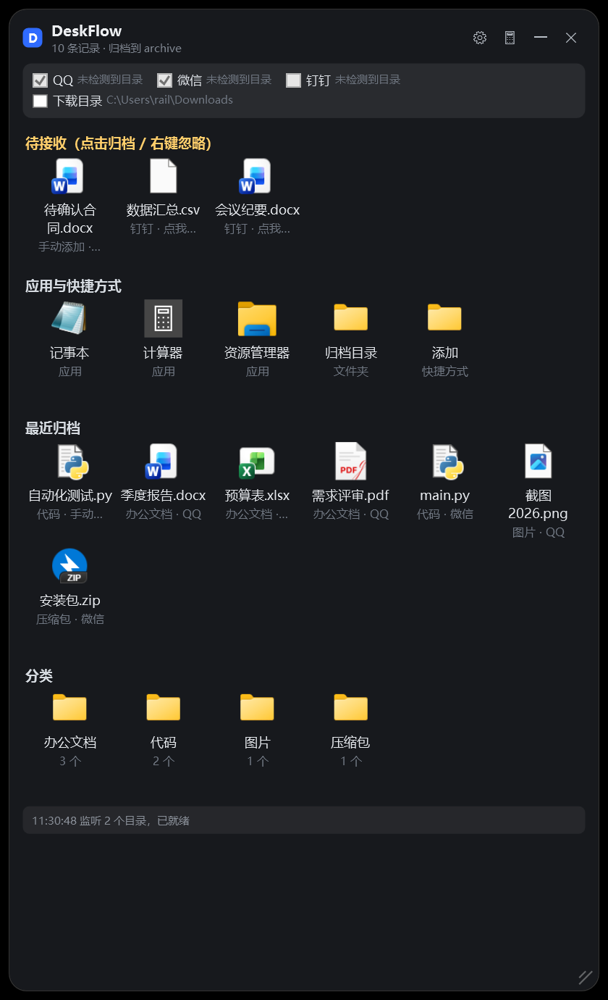
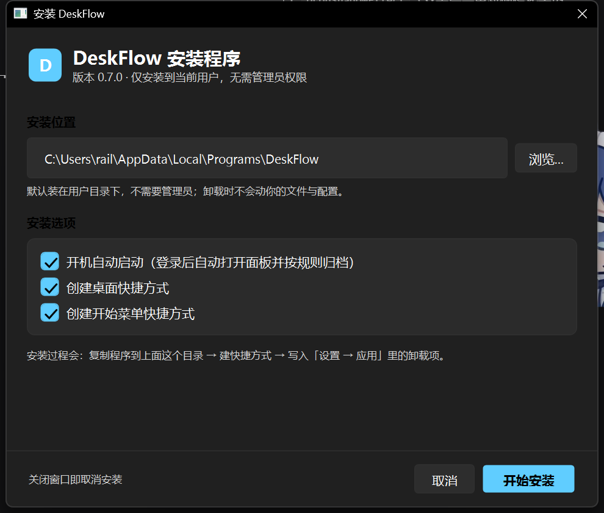

# DeskFlow

常驻 Windows 桌面的**文件管家**：自动接住 QQ / 微信 / 钉钉收到和浏览器下载的文件，按类型分门别类归档；桌面上一个面板就能打开最近的文件、进入分类目录、启动常用程序。


---

## 一、四个任务，现在做到哪一步

| 任务 | 现状 | 怎么用 |
| --- | --- | --- |
| **1. 监听 QQ / 微信 / 钉钉的文件并自动下载** | 已实现（目录监听 + 写完检测）。每个来源独立「自动下载」勾选：勾上 = 发现即归档；不勾 = 只进面板「待接收」，点一下才归档 | 面板顶部四个勾选框；设置 →「监听与自动下载」可加自定义监听目录 |
| **2. 自动归档 + 自动建类别 + 自定义类别** | 已实现。内置 6 类（办公文档/代码/图片/音视频/压缩包/安装包）+ 兜底「其他」，按扩展名自动建 <归档根>/<类别>/；设置里可新建自定义类别，同名会**并集**内置扩展名而不是覆盖丢弃 | 设置 →「分类规则」；归档位置在「归档位置」页 |
| **3. 在软件里打开文件** | 已实现。点图标 = 用系统默认程序打开；右键 = 打开 / 在资源管理器中显示 / 从面板移除 | 面板「最近归档」「待接收」「分类」 |
| **4. 常驻桌面，像截图那样** | 已实现。无边框面板（Win11 走 DWM 圆角），图标取自系统真实图标；**拖边角可改宽高，列数/图标/字号跟着自适应**；标题栏可拖、可「顶住」锁位置 | 面板右上角：顶住 / 设置 / 批处理 / 收起 / 退出；边缘拖动 = 缩放 |

> 明确边界：**没有**去 hook QQ/微信/钉钉客户端进程、也没有逆协议。
> 取舍见 [ADR 0003](docs/adr/0003-file-interception.md)：目录监听对客户端升级免疫、不需要注入、不会被杀软按注入行为拦截。

### 面板可以拖大拖小（内容自适应）

抓住面板任意边或角拖动即可改尺寸，松开后立刻重排并存进配置：

| 宽度 | 列数 | 效果 |
| --- | --- | --- |
| 280–360 | 3 列 | 窄栏贴边，标题自动折两行，副标题按需隐藏 |
| 376（默认） | 4 列 | 与参考图一致 |
| 560 以上 | 6–8 列 | 变成横向看板，一屏扫完最近文件 |




> 文字不会出现"半个字"：格子按当前宽度算好字数预算（中文按全角、ASCII 按 0.56）再截断加省略号，
> 换 DPI、换字体都不会错位；完整名字在鼠标悬停提示里。

### 拖动与「顶住」


- **拖动**：按住标题栏拖动即可移动，走 Windows 原生 `HTCAPTION`，能贴边、不会抖；双击标题栏不会最大化（已吞掉该消息）。
- **顶住**：标题栏右侧第一个按钮（📌）点一下锁死位置，图标变成琥珀色锁 🔒，再点解除。状态存在 `settings.json` 的 `panel.pinned`，下次启动保持。
- **互不干扰**：贴边 14px 内是缩放，标题栏右侧 148px 留给按钮，所以点按钮不会被当成拖窗口；顶住只锁"移动"，拉边角缩放照常可用。

命中规则是一段纯函数（`DeskFlow.Core/Shell/PanelHitTest.cs`），有 9 个自检用例守着：
标题栏 → 可拖、顶住 → 不可拖、按钮区 → 放行点击、四角四边 → 缩放、正文 → 放行点击。

---

## 二、全局监听（整台电脑的落盘即收）


除了盯聊天工具目录，还可以把**整台电脑**纳入监听：只要落下一个你指定类型的文件，就弹提示、移动到归档目录、并删掉原位置的副本。

开启位置：设置 → **全局监听**。

| 选项 | 说明 |
| --- | --- |
| 开启全局监听 | 默认关闭；打开后立刻生效，不用重启 |
| 文件类型 | 标签列表：手动输入 `.psd`（或 `psd`）点「添加」；也可以从 **分类规则里选**（下拉里列出所有已知后缀，选中即加入），或「按分类添加」整类灌进去；标签上的 × 可单独移除，「恢复默认」回到内置 15 种 |
| 监听根目录 | 默认全部固定硬盘，可增删（例如只盯 D 盘） |


命中后：右下角弹卡片（点击可直接打开文件）→ 按类别移动到归档根目录下的类别文件夹 → 原文件被移走（同盘 move，不留副本）。

**安全边界**（写死在 `GlobalWatchFilter`，有 12 条自检用例覆盖）：

- 只处理你勾选的扩展名；0 字节、隐藏/系统/临时文件跳过；
- `~$xxx.docx`、`.tmp / .part / .crdownload` 这类半成品跳过；
- 系统目录（Windows / Program Files / ProgramData / AppData / 回收站等）永不监听；
- 归档根、配置目录、安装目录、聊天工具目录都被排除，不会自噬也不会重复归档；
- 启动时补扫最近 10 分钟落盘的文件（数量与时间都有上限），程序没开时落下的也不漏。

关掉开关即停止；已经归档的文件不会自动还原。
## 三、托盘与常驻

装好（或直接跑 EXE）之后，右下角任务栏会出现 DeskFlow 的托盘图标：蓝底白字 D。

| 托盘菜单 | 作用 |
| --- | --- |
| 打开面板 | 把面板叫回桌面（双击托盘图标同效） |
| 设置… | 打开设置窗口（监听目录 / 自动下载 / 归档位置 / 分类 / 快捷方式） |
| 自动下载 ▸ | 四个来源的开关 + 「扫描一次（近 30 分钟）」，与面板顶部勾选是同一份配置 |
| 重新启动 | 保存配置 → 起新进程 → 退出自己（改完代码/配置后不用手动关开） |
| 退出 | 真正退出：停止监听、保存配置、移除托盘图标 |

面板右上角的 `×` 现在只是**收起到托盘**（第一次会弹气泡提示），程序继续在后台按规则归档；
要彻底退出请走托盘菜单的「退出」。
## 三、安装与卸载



**双击安装包** → 选安装位置、勾开机自启/快捷方式 → 开始安装：

```
dist\DeskFlow-Setup-0.6.0.exe
```

安装界面能改的东西：

| 选项 | 说明 |
| --- | --- |
| 安装位置 | 默认 `%LOCALAPPDATA%\Programs\DeskFlow`，可改成任意目录（建议仍放用户目录，免管理员） |
| 开机自动启动 | 写 `HKCU\...\Run`，登录后自动起面板并继续按规则归档 |
| 创建桌面 / 开始菜单快捷方式 | 两个勾选相互独立 |
| 覆盖安装 | 已装过会提示原安装位置，继续则只替换程序文件，配置与归档记录保留 |

安装做四件事：复制程序 → 建快捷方式 →（可选）开机自启 → 写「设置 → 应用」里的卸载项。


**卸载**：设置 → 应用 → DeskFlow → 卸载（或直接跑 `DeskFlow.exe --uninstall`）。
卸载界面会显示安装位置与占用空间，并给一个「保留我的配置与归档索引」勾选：

- 勾着（默认）：只删程序、快捷方式、开机自启、卸载项；配置/日志/索引留在 `%LOCALAPPDATA%\DeskFlow`，重装即接上；
- 取消勾选：连配置、日志、索引一起删；
- **归档目录里的文件永远不会被删**。

### 静默模式（批量部署 / 自动化）

```powershell
# 安装
.\DeskFlow-Setup-0.6.0.exe --install --silent --dir="D:\Apps\DeskFlow" --autostart=1 --shortcuts=1
# 卸载（保留数据）
"$env:LOCALAPPDATA\Programs\DeskFlow\DeskFlow.exe" --uninstall --silent --keepdata=1
```

退出码 0 = 成功。

### 绿色版（不安装）

```
dist\DeskFlow.exe
```

同一个 exe：不装也能直接用；文件名以 `DeskFlow-Setup` 开头或带 `--install` 时进安装模式，带 `--uninstall` 时进卸载模式。
---

## 四、数据放在哪

| 路径 | 内容 |
| --- | --- |
| `%LOCALAPPDATA%\DeskFlow\settings.json` | 监听目录、自动下载开关、归档根、自定义类别、面板快捷方式、面板坐标 |
| `%LOCALAPPDATA%\DeskFlow\archive-index.json` | 归档索引（来源 / 类别 / 落盘路径 / 状态），面板四块列表都读它 |
| `%LOCALAPPDATA%\DeskFlow\logs\*.log` | 运行日志 |
| `文档\DeskFlow\output\archive\<类别>\` | 归档后的文件本体 |

便携/测试模式：设置环境变量 `DESKFLOW_HOME` 指到任意目录，配置与索引整体搬过去，不动真实用户配置。

---

## 四、架构

```
DeskFlow.App (WPF 面板 + 设置 + 批处理窗口 + CLI)
      ↓ 引用
DeskFlow.Infrastructure   Watch(目录探测/轮询监听) · Archive(归档器) · Index(JSON 索引)
                          · Steps/Sinks(批处理能力) · Settings · Services(Shell)
      ↓ 引用
DeskFlow.Core             Models · Categorization(类别目录) · Abstractions · Runtime(JobEngine)
```

两条主线：

1. **监听归档线**：`SourceDirectoryResolver` 探出 QQ/微信/钉钉/下载目录 → `IncomingWatcher` 每 2 秒轮询、连续两轮大小不变才算写完 → `PanelViewModel.HandleDetected` 判断该来源是否自动下载 → `FileArchiver` 按 `CategoryCatalog` 落盘 → `JsonArchiveIndex` 记账 → 面板刷新。
2. **批处理线**（原有能力，保留）：`JobEngine` = 输入源 → 步骤 × N → 输出目标 → `JobReport`，命令行与「批处理」窗口共用。

硬规则：归档器只搬文件不删原件（除非显式选「移动」）；类别解析永远有兜底「其他」；索引写坏只丢历史、不崩程序。

详见 [docs/architecture.md](docs/architecture.md) 与三份 ADR。

---

## 五、加东西要改哪里

| 想要的 | 动作 |
| --- | --- |
| 支持新的聊天工具 | `SourceDirectoryResolver.Discover()` 加一条候选路径 |
| 新的内置类别 | `DefaultCategories.Create()` 加一行（用户也能在设置里自建，不必改代码） |
| 归档后动作（上传网盘、发通知） | 在 `PanelViewModel.ArchiveAndRecordAsync` 后加一步，或写新的 `IOutputSink` |
| 新的批处理步骤 | 实现 `IPipelineStep`，在 `DefaultJobCatalog.Build()` 注册一行 |
| 面板多一块（如「今天收了多少」） | `PanelViewModel` 加集合，XAML 复制一段 `ItemsControl`（模板 `TileTemplate` 与列数自适应已复用） |
| 调整密度手感 | `PanelViewModel.ApplyPanelWidth`：改 `minTileWidth`（每格最小宽）、列数上下限、字号缩放区间 |

---

## 六、用 VS Code 打开

```powershell
code D:\文件归档          # 或直接双击仓库里的 DeskFlow.code-workspace 不存在时用这条
```

已经配好了 `.vscode/`：

| 文件 | 作用 |
| --- | --- |
| `settings.json` | 排除 bin/obj/dist/.tmp、绑定 `DeskFlow.sln`、WPF/XAML 关联 |
| `tasks.json` | 任务：`build`（默认 Ctrl+Shift+B）、`run: GUI`、`run: checks`、`run: diagnose`、`pack: 单文件 EXE`、`pack: MSI` |
| `launch.json` | 三个调试目标：面板、`--diagnose` 命令行、自检程序 |
| `extensions.json` | 推荐扩展：C#（已装 v2.160.4）、C# Dev Kit、PowerShell |

首次打开如果右下角提示 "C# Dev Kit" 或 "需要还原项目"，点允许即可；
`dotnet` 会自己 restore，之后 `Program.cs` / `*.xaml` 都有智能提示与跳转。

> WPF 的界面调试：在 `DesktopPanelWindow.xaml` 里打断点，按 F5 选「调试 DeskFlow 面板」。
> 注意面板是常驻窗口，调试时可以先在 `App.OnStartup` 里加断点看启动流程。

## 七、构建与自检

需要 .NET SDK 10（本机 10.0.401）。

```powershell
dotnet build DeskFlow.sln
dotnet run --project tests\DeskFlow.Checks      # 75 项零依赖自检
powershell -File build\pack.ps1                # 单文件 EXE → dist\（约 59 MB，自包含）
```

自检覆盖：类别解析与同名并集、归档落盘/判重/改名/移动、监听「写完才报」与去重、索引持久化、设置读写、面板命中（拖动/缩放/顶住）、目录探测（重定向文档 + QQ/微信 3.x/4.x/钉钉布局 + 噪声过滤），以及原有批处理链路。

---

## 八、已知边界

- 监听依赖**客户端默认收文件目录**；若你把文件另存到了别处，用设置里的「自动查找数据目录…」扫盘，或手动添加。
- 目录探测走 `Environment.SpecialFolder.MyDocuments`（跟着"文档"重定向走），不是写死的 `%USERPROFILE%\Documents` —— 后者在把文档挪到 D 盘的机器上一定是空的。
- 客户端装了就一定会出现在面板上：目录还没被创建（还没收到过文件）时显示「等待首次接收」，目录一出现监听立即生效，不用重启。
- 聊天工具目录里的缩略图/表情/日志/数据库缓存会被过滤掉，不会刷屏（`IncomingWatcher.IsNoise`）；启动补扫也走同一套过滤。
- **"发出去的文件"不会在本机落盘**：QQ/微信里发送是上传，只有"接收方/自己下载保存"时才会写进收文件目录。
  所以自测时要在客户端里点一下那个文件让它下载，或让对方发给你。
- QQ 的监听范围是 `<账号>\nt_qq\nt_data` 整棵子树（收文件可能落在 `File\Ori`、`File\FileRecv`、`dataline` 等不同子目录），只盯一个子目录会漏。
- 判重用「长度 + 首 1 MB SHA-256」，不是全文件哈希：几万文件量级够快；同名、同首块但尾部不同的极端情况会走改名 `(2)` 而不是判重。
- 面板按内容自适应高度，超过屏幕工作区后内部滚动；不抢焦点、默认不置顶。
- `dist\` 不进 Git（59 MB 二进制），发版走 Releases。

## 九、已修复的坑（记在这免得再踩）

| 现象 | 根因 | 修法 |
| --- | --- | --- |
| 最小化再打开，面板内容全没了 | `AllowsTransparency=True` 的分层窗口在 Windows 上会丢失合成表面，还原后不重绘 | 改成非分层窗口 + `WindowChrome` + DWM 圆角（`RoundedCorners`）；另外在 `OnStateChanged` 里强制重绘，且最小化期间不把 0 尺寸写进配置 |
| 三个客户端全显示「未检测到目录」 | 探测用死了 `%USERPROFILE%\Documents`，而本机「文档」重定向到了 `D:\docu` | 改用 `SpecialFolder.MyDocuments`；补 QQNT 9.x 的 `nt_qq\nt_data\File`、微信 4.x 的 `msg\file`、钉钉 `DingTalk\<用户>\file`；再加 3 层兜底扫盘 |
| 面板里刷出一堆 .db / 缩略图 | QQ 会把 Thumb/Emoji/log/db 都写在收文件目录旁 | 监听器按路径段过滤噪声目录 |

## 十、下一步候选

- [ ] 托盘图标 + 开机自启 + 全局热键唤起
- [ ] 归档后清理重复文件、按月份/来源建二级目录
- [ ] 分类内文件列表页、面板中键滚动
- [ ] 归档动作插件化（webhook / 网盘 / 备份盘）